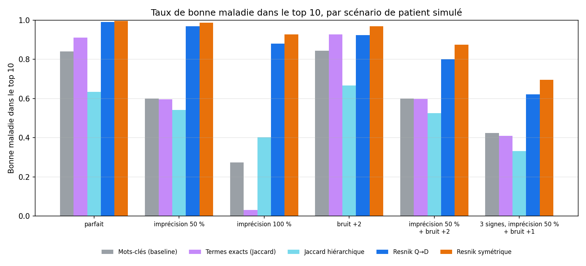

# E1 — Diagnostic différentiel des maladies rares par ontologies

Classement des maladies rares compatibles avec une liste de signes cliniques, par **similarité sémantique** (information content et mesure de Resnik) sur la **Human Phenotype Ontology** (HPO) et les annotations **Orphanet**. Chaque classement est **expliqué** par les phénotypes partagés.

> Démonstrateur pédagogique (cours MSMIS5IN11 — Search & Symbolic AI). Ce n'est pas un dispositif médical.

## Résultats principaux

Évaluation sur 500 patients simulés par scénario (graine 42), HPO `v2026-09-01`, 4 355 maladies Orphanet.

| Scénario | Mots-clés (baseline) | Termes exacts | Resnik Q→D | **Resnik symétrique** |
|---|---|---|---|---|
| Profil parfait (5 signes) — top 10 | 84 % | 91 % | 99 % | **99,6 %** |
| Imprécision 100 % — top 10 | 27 % | 3 % | 88 % | **93 %** |
| Imprécision 50 % + bruit +2 — top 10 | 60 % | 60 % | 80 % | **87 %** |
| Imprécision 50 % + bruit +2 — top 1 | 34 % | 32 % | 40 % | **53 %** |



Extensions :

- **Signes absents** : top 10 de 60 % à 67 % (pénalité λ = 1).
- **Question suivante** (gain d'information) : top 1 de 9 % à 30,5 % en 3 questions, contre 12,5 % avec des questions au hasard.
- **Raisonnement OWL (HermiT)** sur 1 097 maladies du tissu conjonctif, en 8 s environ. Ses résultats sont identiques au calcul par fermetures sur ce sous-domaine. Le contrôle sur la base complète retrouve deux maladies aux annotations contradictoires ; une figure dans le sous-domaine illustré dans le notebook.

Le détail et l'analyse sont dans [`notebooks/demo.ipynb`](notebooks/demo.ipynb).

## Installation

Python 3.10 ou plus récent. Java (≥ 11) n'est nécessaire que pour l'extension OWL (raisonneur HermiT fourni par owlready2).

```bash
cd groupe-maladies-rares
python -m venv .venv
source .venv/bin/activate          # Windows : .venv\Scripts\activate
pip install -r requirements.txt
pip install -e .                    # rend le paquet `rarediag` importable
python scripts/download_data.py     # ~47 Mo : hp.obo + phenotype.hpoa, version figée, SHA-256 contrôlés
```

Les données ne sont **pas** versionnées (`data/` est dans `.gitignore`). Le projet n'utilise aucun service externe ni clé d'API : aucun fichier `.env` n'est nécessaire. Le fichier `.env.example` documente uniquement la variable facultative `RAREDIAG_DATA`.

## Utilisation

**Chercher un terme HPO :**

```bash
python -m rarediag.cli search "ectopia lentis"
```

**Classer les maladies pour un patient**, avec explications, signes absents et question suivante :

```bash
python -m rarediag.cli diagnose HP:0001166 HP:0001083 HP:0002616 HP:0000098 --explain 3
python -m rarediag.cli diagnose HP:0001166 HP:0001083 --absent HP:0001250 --next
python -m rarediag.cli diagnose HP:0001166 HP:0001083 --json results/diagnostic.json
```

**Interface web :**

```bash
streamlit run app.py
```

**Reproduire l'évaluation** (environ 3 min) puis refaire les figures :

```bash
python -m rarediag.evaluate --n 500 --seed 42 --out results
python -m rarediag.evaluate --plot-only --out results
```

**Tests et vérification indépendante :**

```bash
pytest                                                       # 51 tests (jeu jouet + données réelles)
python verifier/verify.py diagnostic results/diagnostic.json --full
python verifier/verify.py evaluation results --sample 30
```

## Méthode

1. **Ontologie** : `hp.obo` est lu par un parseur dédié (`ontology.py`), restreint au sous-arbre `HP:0000118 Phenotypic abnormality`. Les identifiants secondaires (`alt_id`) et obsolètes (`replaced_by`) sont résolus.
2. **Annotations** : `phenotype.hpoa` est filtré sur `ORPHA:`, aspect `P`. Les fréquences HPO sont converties en probabilités. Les annotations `NOT` sont gardées à part.
3. **Propagation** (*true path rule*) : une maladie annotée par un terme l'est aussi par tous ses ancêtres.
4. **Information content** : IC(t) = −log p(t), où p(t) est la proportion de maladies annotées par t après propagation. Un terme jamais annoté reçoit l'IC maximal, ce qui préserve IC(enfant) ≥ IC(parent).
5. **Resnik** : sim(t₁, t₂) = IC de l'ancêtre commun le plus informatif (MICA).
6. **Score patient/maladie** (*best-match average*, Köhler et al. 2009) : score(Q→D) = moyenne sur q ∈ Q de max_{t∈D} sim(q, t). La version symétrique fait la moyenne de Q→D et D→Q.
7. **Optimisation** : max_{t∈D} sim(q, t) est l'IC maximal parmi les ancêtres de q présents dans la fermeture de D. Avec un index inversé, classer 4 355 maladies prend environ 1 ms.
8. **Explication** : pour chaque signe, on donne le phénotype apparié, le MICA, l'IC, la fréquence et le type de relation (identique, plus précis, plus général, apparenté).

**Protocole d'évaluation** (inspiré de Köhler et al., 2009) : on tire des phénotypes d'une maladie pondérés par leur fréquence. Deux dégradations sont ensuite appliquées. L'*imprécision* remplace un signe par un parent. Le *bruit* ajoute des signes sans rapport avec la maladie. On mesure le rang de la bonne maladie (ex æquo départagés en moyenne), le top-1, le top-10 et le MRR.

Trois baselines servent de comparaison : le recouvrement de mots-clés des libellés (Jaccard), le recouvrement des identifiants exacts, et le Jaccard sur les fermetures (hiérarchie sans IC).

## Organisation du dépôt

```
├── README.md
├── app.py                      # interface Streamlit
├── pyproject.toml / requirements.txt
├── scripts/download_data.py    # téléchargement figé + SHA-256
├── src/rarediag/
│   ├── ontology.py             # parseur OBO, ancêtres, sous-arbre, alias
│   ├── annotations.py          # lecture de phenotype.hpoa, fréquences, NOT
│   ├── similarity.py           # IC, MICA, Resnik, scores vectorisés, signes absents
│   ├── baseline.py             # mots-clés, termes exacts, Jaccard hiérarchique
│   ├── explain.py              # explication des classements
│   ├── simulate.py             # patients simulés (imprécision, bruit, absents)
│   ├── next_question.py        # question suivante (gain d'information)
│   ├── owl_reasoning.py        # traduction OWL + HermiT, cohérence des annotations
│   ├── evaluate.py             # expériences, métriques, figures
│   └── cli.py                  # ligne de commande
├── verifier/verify.py          # vérificateur indépendant (pronto + calcul naïf)
├── tests/                      # pytest, dont une mini-ontologie jouet calculable à la main
├── notebooks/demo.ipynb        # notebook explicatif exécuté
├── results/                    # résultats d'évaluation (CSV, JSON, figures)
└── slides/                     # support de soutenance
```

## Vérificateur indépendant

`verifier/verify.py` ne réutilise aucun code du paquet. Il relit l'ontologie avec **pronto** et les annotations avec **pandas**, recalcule l'IC depuis zéro, et calcule Resnik par la définition directe, paire par paire.

- **Mode diagnostic** : il contrôle la version HPO, l'ordre du classement et les scores sans pénalité de signes absents. Pour chaque explication, il vérifie que le MICA est un ancêtre commun, que l'IC est exact et que la somme des contributions est cohérente. Avec `--full`, il vérifie aussi qu'aucune maladie non listée n'a un meilleur score.
- **Mode évaluation** : il contrôle la cohérence entre `summary.csv` et `ranks.csv`, puis recalcule entièrement le rang d'un échantillon de patients.

Un test (`tests/test_verifier.py`) s'assure qu'il **rejette** un résultat volontairement altéré.

## Limites

- Les patients sont simulés à partir des annotations elles-mêmes, ce qui est optimiste par rapport à des cas réels.
- L'IC dépend du corpus d'annotations choisi (ici Orphanet seul).
- Les fréquences interviennent dans la simulation et les extensions, mais ne pondèrent pas le score principal.
- Le filtre OWL est exact mais tout-ou-rien : un signe bruité suffit à exclure la bonne maladie. C'est pourquoi il complète la similarité graduée sans la remplacer.

## Données, licences et références

- **Human Phenotype Ontology**, release `v2026-09-01` (https://hpo.jax.org). Utilisation soumise à la licence HPO, avec citation obligatoire : Gargano M.A. et al., *The Human Phenotype Ontology in 2024: phenotypes around the world*, Nucleic Acids Research, 2024.
- **Annotations Orphanet**, distribuées dans `phenotype.hpoa` (Orphanet, INSERM).
- Köhler S. et al., *Clinical diagnostics in human genetics with semantic similarity searches in ontologies*, AJHG 85(4):457-464, 2009.
- Resnik P., *Using information content to evaluate semantic similarity in a taxonomy*, IJCAI 1995.
- Bibliothèques : numpy, pandas, matplotlib, pronto, owlready2 (HermiT), streamlit, pytest.
- Notebooks du cours CoursIA : SW-7b-Python-OWL, SW-13-Python-Reasoners.

Code du projet sous licence MIT.

## Équipe et contributions

Le groupe comprend deux membres. Avant publication, renseigner le compte GitHub du premier membre et les contributions réelles. Cette archive ne présume pas de la répartition du développement.

| Membre | Contribution au développement |
|---|---|
| @jay07-beep | À renseigner par le groupe |
| @MathisGramaglia | À renseigner par le groupe |

Répartition de soutenance préparée : premier membre, slides 1–3, 6–8 et 13 ; second membre, slides 4–5 et 9–12.

## Assistance par IA et préparation de cette archive

L'assistance de Claude pour le développement initial est déclarée dans le commit de Mathis. ChatGPT/Codex a participé à l'explication du code, aux vérifications et à la préparation de ce dossier. Les fichiers reçus ont été réorganisés. Les fixtures originales, absentes des fichiers joints à la conversation, ont été récupérées dans le dépôt de Mathis. Aucun test n'a été désactivé. Le groupe doit déclarer également l'aide reçue lors du développement initial, selon son usage réel, et relire le dossier avant publication.

Le détail des commandes et des vérifications effectuées pour cette archive figure dans `VALIDATION.md`.
